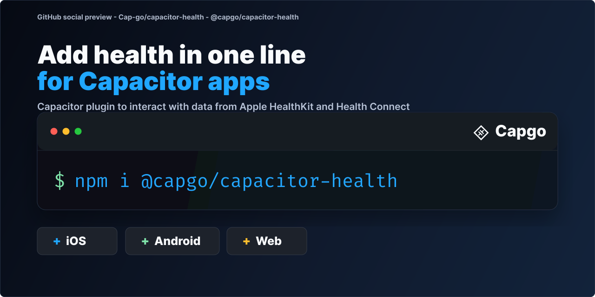

# @capgo/capacitor-health

Read and write health data with Apple HealthKit on iOS and Health Connect on Android through one API. Build fitness, wellness and medical apps once.

<a href="https://capgo.app/?ref=plugin_health"></a>

<div align="center">
  <p><b>Capgo</b>: push fixes to your Capacitor users in minutes, build signed iOS and Android apps without a Mac, and roll back in one click.</p>
  <h2><a href="https://capgo.app/register/?ref=plugin_health">➡️ Get started for free</a></h2>
  <p>14-day unlimited free trial. No credit card required</p>
</div>

> 🤖 **Building with an AI coding agent?** Install [Capgo skills](https://capgo.app/skills/?ref=plugin_health) so Claude Code, Codex, Cursor, Copilot, or Gemini CLI know how to install and use `@capgo/capacitor-health` in your Capacitor app: `npx skills add Cap-go/capgo-skills`. Then ask your agent: *"Add @capgo/capacitor-health to my Capacitor app and wire it up."* [Agent setup guides](https://capgo.app/agents/?ref=plugin_health) · [Hosted MCP](https://capgo.app/docs/ai/mcp/?ref=plugin_health)

<p align="center">
  
</p>

## Key features

- **Read samples**: `readSamples()` for steps, heart rate, sleep and other types over a time range.
- **Write samples**: `saveSample()` stores a single sample.
- **Write workouts**: `saveWorkout()` stores a complete workout with its route, heart rate, distance and active energy.
- **Delete**: `deleteSamples()` removes samples and workouts the app saved, by `clientRecordId` or `platformId`.
- **Workouts and aggregates**: `queryWorkouts()` and `queryAggregated()` for summaries.
- **Authorization**: `requestAuthorization()` and `checkAuthorization()` per data type.
- **Health Connect helpers**: `openHealthConnectSettings()` and `showPrivacyPolicy()` on Android.
- **Platforms**: iOS and Android. A few data types and units differ between iOS and Android, see the Supported data types table below. Not available on web.

## Why Capacitor Health?

The only **free**, **unified** health data plugin for Capacitor supporting the latest native APIs:

- **Health Connect (Android)** - Uses Google's newest health platform (replaces deprecated Google Fit)
- **HealthKit (iOS)** - Full integration with Apple's health framework
- **Unified API** - Same TypeScript interface across platforms with consistent units
- **Multiple metrics** - Steps, distance, calories, heart rate, weight
- **Read & Write** - Query historical data and save new health entries
- **Modern standards** - Supports Android 8.0+ and iOS 14+
- **Modern package management** - Supports both Swift Package Manager (SPM) and CocoaPods (SPM-ready for Capacitor 8)

Perfect for fitness apps, health trackers, wellness platforms, and medical applications.

## Documentation

The most complete doc is available here: https://capgo.app/docs/plugins/health/

## Compatibility

| Plugin version | Capacitor compatibility | Maintained |
| -------------- | ----------------------- | ---------- |
| v8.\*.\*       | v8.\*.\*                | ✅          |
| v7.\*.\*       | v7.\*.\*                | On demand   |
| v6.\*.\*       | v6.\*.\*                | ❌          |
| v5.\*.\*       | v5.\*.\*                | ❌          |

> **Note:** The major version of this plugin follows the major version of Capacitor. Use the version that matches your Capacitor installation (e.g., plugin v8 for Capacitor 8). Only the latest major version is actively maintained.

## Install

You can use our AI-Assisted Setup to install the plugin. Add the Capgo skills to your AI tool using the following command:

```bash
npx skills add https://github.com/cap-go/capacitor-skills --skill capacitor-plugins
```

Then use the following prompt:

```text
Use the `capacitor-plugins` skill from `cap-go/capacitor-skills` to install the `@capgo/capacitor-health` plugin in my project.
```

If you prefer Manual Setup, install the plugin by running the following commands and follow the platform-specific instructions below:

```bash
npm install @capgo/capacitor-health
npx cap sync
```

## iOS Setup

1. Open your Capacitor application's Xcode workspace and enable the **HealthKit** capability.
2. Provide usage descriptions in `Info.plist` (update the copy for your product):

```xml
<key>NSHealthShareUsageDescription</key>
<string>This app reads your health data to personalise your experience.</string>
<key>NSHealthUpdateUsageDescription</key>
<string>This app writes new health entries that you explicitly create.</string>
```

## Android Setup

This plugin now uses [Health Connect](https://developer.android.com/health-and-fitness/guides/health-connect) instead of Google Fit. Make sure your app meets the requirements below:

1. **Min SDK 26+.** Health Connect is only available on Android 8.0 (API 26) and above. The plugin's Gradle setup already targets this level.
2. **Declare Health permissions.** The plugin manifest ships with the required `<uses-permission>` declarations for basic data types (`READ_/WRITE_STEPS`, `READ_/WRITE_DISTANCE`, `READ_/WRITE_ACTIVE_CALORIES_BURNED`, `READ_/WRITE_HEART_RATE`, `READ_/WRITE_WEIGHT`, `READ_/WRITE_SLEEP`, `READ_/WRITE_RESPIRATORY_RATE`, `READ_/WRITE_OXYGEN_SATURATION`, `READ_/WRITE_RESTING_HEART_RATE`, `READ_/WRITE_HEART_RATE_VARIABILITY`). Your app does not need to duplicate them, but you must surface a user-facing rationale because the permissions are considered health sensitive.
3. **Ensure Health Connect is installed.** Devices on Android 14+ include it by default. For earlier versions the user must install _Health Connect by Android_ from the Play Store. The `Health.isAvailable()` helper exposes the current status so you can prompt accordingly.
4. **Request runtime access.** The plugin opens the Health Connect permission UI when you call `requestAuthorization`. You should still handle denial flows (e.g., show a message if `checkAuthorization` reports missing scopes).
5. **Provide a Privacy Policy.** Health Connect requires apps to display a privacy policy explaining how health data is used. See the [Privacy Policy Setup](#privacy-policy-setup) section below.

If you already used Google Fit in your project you can remove the associated dependencies (`play-services-fitness`, `play-services-auth`, OAuth configuration, etc.).

### Privacy Policy Setup

Health Connect requires your app to provide a privacy policy that explains how you handle health data. When users tap "Privacy policy" in the Health Connect permissions dialog, your app must display this information.

**Option 1: HTML file in assets (recommended for simple cases)**

Place an HTML file at `android/app/src/main/assets/public/privacypolicy.html`:

```html
<!DOCTYPE html>
<html>
  <head>
    <meta charset="utf-8" />
    <meta name="viewport" content="width=device-width, initial-scale=1" />
    <title>Privacy Policy</title>
  </head>
  <body>
    <h1>Privacy Policy</h1>
    <p>Your privacy policy content here...</p>
    <h2>Health Data</h2>
    <p>Explain how you collect, use, and protect health data...</p>
  </body>
</html>
```

**Option 2: Custom URL (recommended for hosted privacy policies)**

Add a string resource to your app's `android/app/src/main/res/values/strings.xml`:

```xml
<resources>
    <!-- Your other strings... -->
    <string name="health_connect_privacy_policy_url">https://yourapp.com/privacy-policy</string>
</resources>
```

This URL will be loaded in a WebView when the user requests to see your privacy policy.

**Programmatic access:**

You can also show the privacy policy or open Health Connect settings from your app:

```ts
// Show the privacy policy screen
await Health.showPrivacyPolicy();

// Open Health Connect settings (useful for managing permissions)
await Health.openHealthConnectSettings();
```

## Usage

```ts
import { Health } from '@capgo/capacitor-health';

// Verify that the native health SDK is present on this device
const availability = await Health.isAvailable();
if (!availability.available) {
  console.warn('Health access unavailable:', availability.reason);
}

// Ask for separate read/write access scopes
await Health.requestAuthorization({
  read: ['steps', 'heartRate', 'weight'],
  write: ['weight'],
});

// Query the last 50 step samples from the past 24 hours
const { samples } = await Health.readSamples({
  dataType: 'steps',
  startDate: new Date(Date.now() - 24 * 60 * 60 * 1000).toISOString(),
  endDate: new Date().toISOString(),
  limit: 50,
});

// Persist a new body-weight entry (kilograms by default)
await Health.saveSample({
  dataType: 'weight',
  value: 74.3,
});
```

### Supported data types

| Identifier              | Default unit  | Notes                                                    |
| ----------------------- | ------------- | -------------------------------------------------------- |
| `steps`                 | `count`       | Step count deltas                                        |
| `distance`              | `meter`       | Walking / running distance                               |
| `calories`              | `kilocalorie` | Active energy burned                                     |
| `heartRate`             | `bpm`         | Beats per minute                                         |
| `weight`                | `kilogram`    | Body mass                                                |
| `sleep`                 | `minute`      | Sleep sessions with duration and states                  |
| `respiratoryRate`       | `bpm`         | Breaths per minute                                       |
| `oxygenSaturation`      | `percent`     | Blood oxygen saturation (SpO2)                           |
| `restingHeartRate`      | `bpm`         | Resting heart rate                                       |
| `heartRateVariability`  | `millisecond` | Heart rate variability (HRV)                             |
| `vo2Max`                | `mL/min/kg`   | VO2 max                                                  |
| `bloodPressure`         | `mmHg`        | Blood pressure (requires systolic/diastolic values)      |
| `bloodGlucose`          | `mg/dL`       | Blood glucose level                                      |
| `bodyTemperature`       | `celsius`     | Body temperature                                         |
| `height`                | `centimeter`  | Body height                                              |
| `flightsClimbed`        | `count`       | Floors / flights of stairs climbed                       |
| `exerciseTime`          | `minute`      | Apple Exercise Time (iOS only)                           |
| `distanceCycling`       | `meter`       | Cycling distance                                         |
| `bodyFat`               | `percent`     | Body fat percentage                                      |
| `basalBodyTemperature`  | `celsius`     | Basal body temperature                                   |
| `basalCalories`         | `kilocalorie` | Basal metabolic rate / resting energy                    |
| `totalCalories`         | `kilocalorie` | Total energy burned (active + basal)                     |
| `mindfulness`           | `minute`      | Mindfulness / meditation sessions                        |
| `appleStandHour`        | `count`       | Apple Watch stand hours (iOS only, read-only; 1 = stood) |
| `dietaryWater`          | `liter`       | Water consumed                                           |
| `dietaryEnergyConsumed` | `kilocalorie` | Dietary energy (calories) consumed                       |
| `stateOfMind`           | `valence`     | State of Mind (iOS 18+, read-only; value = valence -1...1) |
| `workouts`              | N/A           | Workout sessions (read with `queryWorkouts()`, write with `saveWorkout()`) |
| `workoutRoute`          | N/A           | Workout GPS routes (write-only, use with `saveWorkout()`) |

All write operations expect the default unit shown above. On Android the `metadata` option is currently ignored by Health Connect.

**Blood Pressure:** Blood pressure requires both systolic and diastolic values:

```ts
await Health.saveSample({
  dataType: 'bloodPressure',
  value: 120, // systolic value (used as main value)
  systolic: 120,
  diastolic: 80,
  startDate: new Date().toISOString(),
});

// Reading blood pressure returns samples with systolic/diastolic fields
const { samples } = await Health.readSamples({
  dataType: 'bloodPressure',
  startDate: new Date(Date.now() - 24 * 60 * 60 * 1000).toISOString(),
  endDate: new Date().toISOString(),
});

samples.forEach((sample) => {
  console.log(`BP: ${sample.systolic}/${sample.diastolic} mmHg`);
});
```

**Note about workouts:** To query workout data using `queryWorkouts()`, you need to explicitly request `workouts` permission:

```ts
await Health.requestAuthorization({
  read: ['steps', 'workouts'], // Include 'workouts' to access workout sessions
});
```

### Saving workouts

`saveWorkout()` writes a finished workout with its GPS route, pauses, distance, active energy and heart
rate. It never writes steps.

- **Android:** a single atomic Health Connect insert of one exercise session (with route and pauses)
  plus a distance, an active-calories and a heart-rate record when you provide those values.
- **iOS:** an `HKWorkoutBuilder` saves the workout with its distance, active-energy and heart-rate
  samples (one per reading) and pause / resume events; the route is then attached through the
  builder's `HKWorkoutRouteBuilder`.

```ts
await Health.requestAuthorization({
  // add 'distanceCycling' for cycling workouts on iOS
  write: ['workouts', 'workoutRoute', 'distance', 'calories', 'heartRate'],
});

const { platformId, routeSaved, skippedRecords } = await Health.saveWorkout({
  workoutType: 'running',
  startDate: '2026-03-01T07:00:00.000Z',
  endDate: '2026-03-01T07:42:10.000Z',
  clientRecordId: 'run-7f3c2a9e', // retry-safe: saving again with this id replaces instead of duplicating
  title: 'Morning run',
  totalDistance: 8240, // meters
  totalEnergyBurned: 612, // active kilocalories
  heartRateSamples: [{ date: '2026-03-01T07:00:05.000Z', bpm: 96 }],
  route: [{ date: '2026-03-01T07:00:02.000Z', latitude: -34.6037, longitude: -58.3816, altitude: 25 }],
  pauses: [{ startDate: '2026-03-01T07:20:00.000Z', endDate: '2026-03-01T07:21:30.000Z' }],
});
```

- **Permissions:** only `workouts` write access is required; without it the call rejects with code
  `permission-denied` and nothing is written. Users can deny single types in the permission sheet, so a
  missing `distance`, `calories` or `heartRate` write permission never fails the save: the workout is
  stored without that record and `skippedRecords` lists it (`'distance'`, `'energy'`, `'heartRate'`).
  Likewise the route needs `workoutRoute` write access; without it the workout is stored without the
  route and `routeSaved` is `false`. The Android plugin manifest declares `WRITE_EXERCISE` and
  `WRITE_EXERCISE_ROUTE`. On iOS, `workoutRoute` also requests read and share access to workouts and
  read access to routes, which Apple requires for route data.
- **Device locked (iOS):** code `workout-saved-unavailable` means HealthKit saved the workout but could
  not return it because the device is locked, so the route was not saved and there is no `platformId`.
  With a `clientRecordId` you can retry safely: the sync identifier replaces the saved copy.
- **Distance on iOS:** walking, running and hiking use `distanceWalkingRunning` (`distance` write
  access), cycling uses `distanceCycling` (`distanceCycling` write access). Other workout types have no
  matching HealthKit distance type: the distance is not saved and `skippedRecords` lists `'distance'`.
- **Retries:** pass a stable `clientRecordId` so retrying an uncertain save replaces the earlier copy
  instead of duplicating it (Health Connect `clientRecordId`, HealthKit `HKMetadataKeySyncIdentifier`
  plus a sync version). On Android a later save also deletes the derived records it no longer writes.
  On iOS HealthKit only replaces the objects saved again: a distance, energy or route the later save
  leaves out, and heart-rate readings beyond its count, stay. Retry with the same data, or delete the
  workout before saving different contents.
- **Samples outside the workout:** heart-rate readings and route locations outside the workout window
  (`startDate` inclusive, `endDate` exclusive) are dropped, as are route locations in the same
  millisecond as an earlier one. The result reports how many in `droppedHeartRateSamples` and
  `droppedRouteLocations`.
  Invalid values (for example a latitude out of range or `bpm` outside 1 to 300) reject the call with
  a message naming the field.
- **Pauses:** they must lie within the workout and must not overlap. Android stores them as Health
  Connect exercise segments of type pause (`EXERCISE_SEGMENT_TYPE_PAUSE`, valid for every workout type);
  iOS adds pause / resume events, and HealthKit leaves the paused time out of the workout duration.
- **Title and metadata:** `title` is not saved on iOS (HealthKit workouts have no title). `metadata` is
  ignored on Android (Health Connect has no custom metadata); on iOS its string values are saved on the
  workout, and keys starting with `HK` are rejected.
- **Swimming on iOS:** `swimmingPool` and `swimmingOpenWater` are saved as swimming workouts with a pool
  or open-water location, so `queryWorkouts()` reports both as `swimming`.

### Deleting samples and workouts

`saveSample()` accepts the same `clientRecordId` idempotency key as `saveWorkout()` (plus an optional
`recordingMethod`). Pass that id to `deleteSamples()` to delete the record later, or use a `platformId`
returned by `saveWorkout()`, `readSamples()` or `queryWorkouts()`:

```ts
await Health.saveSample({
  dataType: 'weight',
  value: 74.3,
  clientRecordId: 'weight-c41e9b07', // same id again => replaces, never duplicates
});

// Delete by the id you chose (platformIds work too)
await Health.deleteSamples({ dataType: 'weight', clientRecordIds: ['weight-c41e9b07'] });
await Health.deleteSamples({ dataType: 'workouts', clientRecordIds: ['run-7f3c2a9e'] });
```

- **Own records only:** Health Connect and HealthKit only let an app delete the records it wrote, and
  deleting needs write access to the type (`permission-denied` otherwise). Give at least one id and at
  most 100 ids per call.
- **Workouts:** `dataType: 'workouts'` also deletes the workout's companion records. On iOS that is the
  distance, active-energy and heart-rate samples and the route associated with each workout; finding
  the workouts needs read access to workouts (`read: ['workouts']`). On Android it is the distance,
  active-calories and heart-rate records saved for the given `clientRecordIds` (with `platformIds` only
  the exercise session is deleted). `workoutRoute` cannot be deleted on its own.
- **Blood pressure on iOS:** deleting it also looks the correlation up first, so request
  `read: ['bloodPressure']` as well.
- **Count and unknown ids:** on iOS `deleted` is the number of records of `dataType` actually deleted.
  Health Connect does not report counts, so on Android `deleted` is the number of ids requested.
  Android 14 and later ignore ids that match nothing; Health Connect documents that such an id fails
  the whole call, so on Android 13 and lower the call can reject with `delete-samples-failed`.
- **Recording method:** omitted, `saveSample()` behaves as before (Android manual entry, no flag on
  iOS). `manualEntry` sets `HKMetadataKeyWasUserEntered` on iOS; `activelyRecorded` marks the record as
  actively recorded on Android.

### Reading data older than 30 days (Android)

On Android, Health Connect caps reads to roughly the **last 30 days** unless your app holds the
`android.permission.health.READ_HEALTH_DATA_HISTORY` permission. To read older history, set
`requestHistoryAccess: true` on your normal `requestAuthorization()` call. The permission then
appears in the first-time Health Connect permission sheet alongside your data-type permissions,
instead of forcing users to grant it manually in Health Connect settings.

```ts
const status = await Health.requestAuthorization({
  read: ['steps', 'heartRate'],
  write: [],
  requestHistoryAccess: true,
});

// On Android, whether the history permission was granted:
console.log(status.historyAccessAuthorized); // true | false
// And whether the provider supports it at all:
console.log(status.historyAccessAvailable); // true | false
```

The result is reported back as the top-level `historyAccessAuthorized` boolean (present only when
`requestHistoryAccess` was set). The same option works with `checkAuthorization()`.

The `READ_HEALTH_DATA_HISTORY` permission only exists on sufficiently new Health Connect providers
(Android 14 extension 13+ or Health Connect APK 171302+). On an older but otherwise supported
provider the permission can never be granted, so the plugin checks
[feature availability](https://developer.android.com/health-and-fitness/health-connect/features/availability)
and **silently skips** the history permission when it is unavailable, your normal read/write scopes
are still requested as usual. In that case the status reports `historyAccessAvailable: false` (and
`historyAccessAuthorized: false`), which lets you distinguish "the device can't do this" from "the
user denied it" and avoid re-prompting. `historyAccessAvailable` is omitted unless
`requestHistoryAccess` was set, and always omitted on iOS.

You must **also** declare the permission in your app's `AndroidManifest.xml`:

```xml
<uses-permission android:name="android.permission.health.READ_HEALTH_DATA_HISTORY" />
```

Health Connect only shows permissions that are both declared in the manifest and passed to the
permission request, so this declaration is required for `requestHistoryAccess` to take effect. On
iOS, HealthKit has no equivalent permission and no 30-day read cap, so `requestHistoryAccess` is
ignored and `historyAccessAuthorized` is omitted from the returned status.

See Google's documentation on
[reading historical Health Connect data](https://developer.android.com/health-and-fitness/guides/health-connect/develop/read-data#read-restriction)
for more details.

**Pagination example:** Use the `anchor` parameter to paginate through workout results:

```ts
// First page: get the first 10 workouts
let result = await Health.queryWorkouts({
  startDate: new Date(Date.now() - 30 * 24 * 60 * 60 * 1000).toISOString(), // Last 30 days
  endDate: new Date().toISOString(),
  limit: 10,
});

console.log(`Found ${result.workouts.length} workouts`);

// If there are more results, the anchor will be set
while (result.anchor) {
  // Next page: use the anchor to continue from where we left off
  result = await Health.queryWorkouts({
    startDate: new Date(Date.now() - 30 * 24 * 60 * 60 * 1000).toISOString(),
    endDate: new Date().toISOString(),
    limit: 10,
    anchor: result.anchor, // Continue from the last result
  });

  console.log(`Found ${result.workouts.length} more workouts`);
}
```

### New Data Types Examples

**Sleep data:**
```ts
// Request permission for sleep data
await Health.requestAuthorization({
  read: ['sleep'],
});

// Read sleep sessions from the past week
const { samples } = await Health.readSamples({
  dataType: 'sleep',
  startDate: new Date(Date.now() - 7 * 24 * 60 * 60 * 1000).toISOString(),
  endDate: new Date().toISOString(),
});

samples.forEach(sample => {
  console.log(`Sleep: ${sample.value} minutes, state: ${sample.sleepState}`);
});
```

**Respiratory rate, oxygen saturation, and HRV:**
```ts
// Request permission
await Health.requestAuthorization({
  read: ['respiratoryRate', 'oxygenSaturation', 'restingHeartRate', 'heartRateVariability'],
});

// Read respiratory rate
const { samples: respiratoryRate } = await Health.readSamples({
  dataType: 'respiratoryRate',
  startDate: new Date(Date.now() - 24 * 60 * 60 * 1000).toISOString(),
  endDate: new Date().toISOString(),
});

// Read oxygen saturation (SpO2)
const { samples: oxygenSat } = await Health.readSamples({
  dataType: 'oxygenSaturation',
  startDate: new Date(Date.now() - 24 * 60 * 60 * 1000).toISOString(),
  endDate: new Date().toISOString(),
});
```

### Aggregated Queries

For large date ranges, use `queryAggregated()` to get aggregated data efficiently instead of fetching individual samples:

```ts
// Get daily step totals for the past month
const { samples } = await Health.queryAggregated({
  dataType: 'steps',
  startDate: new Date(Date.now() - 30 * 24 * 60 * 60 * 1000).toISOString(),
  endDate: new Date().toISOString(),
  bucket: 'day',        // Options: 'hour', 'day', 'week', 'month'
  aggregation: 'sum',   // Options: 'sum', 'average', 'min', 'max'
});

samples.forEach(sample => {
  console.log(`${sample.startDate}: ${sample.value} ${sample.unit}`);
});

// Request several aggregations at once by passing an array. Each result is returned
// in `sample.values`, keyed by aggregation name (`sample.value` holds the first one).
const { samples: hr } = await Health.queryAggregated({
  dataType: 'heartRate',
  startDate: new Date(Date.now() - 7 * 24 * 60 * 60 * 1000).toISOString(),
  endDate: new Date().toISOString(),
  bucket: 'day',
  aggregation: ['average', 'min', 'max'],
});

hr.forEach(sample => {
  console.log(`${sample.startDate}: avg=${sample.values.average}, min=${sample.values.min}, max=${sample.values.max}`);
});
```

**Note:** Aggregated queries are not supported for sleep, respiratory rate, oxygen saturation, heart rate variability, and VO2 max data types. These measurements should use `readSamples()`, not `queryAggregated()`. Aggregation is supported for: steps, distance, calories, dietary water, dietary energy consumed, heart rate, weight, and resting heart rate.

## API

<docgen-index>

* [`isAvailable()`](#isavailable)
* [`requestAuthorization(...)`](#requestauthorization)
* [`checkAuthorization(...)`](#checkauthorization)
* [`readSamples(...)`](#readsamples)
* [`saveSample(...)`](#savesample)
* [`deleteSamples(...)`](#deletesamples)
* [`getPluginVersion()`](#getpluginversion)
* [`openHealthConnectSettings()`](#openhealthconnectsettings)
* [`showPrivacyPolicy()`](#showprivacypolicy)
* [`queryWorkouts(...)`](#queryworkouts)
* [`saveWorkout(...)`](#saveworkout)
* [`queryAggregated(...)`](#queryaggregated)
* [Interfaces](#interfaces)
* [Type Aliases](#type-aliases)

</docgen-index>

<docgen-api>
<!--Update the source file JSDoc comments and rerun docgen to update the docs below-->

### isAvailable()

```typescript
isAvailable() => Promise<AvailabilityResult>
```

Returns whether the current platform supports the native health SDK.

**Returns:** <code>Promise&lt;<a href="#availabilityresult">AvailabilityResult</a>&gt;</code>

--------------------


### requestAuthorization(...)

```typescript
requestAuthorization(options: AuthorizationOptions) => Promise<AuthorizationStatus>
```

Requests read/write access to the provided data types.

Set `requestHistoryAccess: true` to additionally request Android's
`READ_HEALTH_DATA_HISTORY` permission in the same Health Connect permission sheet
(see {@link <a href="#authorizationoptions">AuthorizationOptions.requestHistoryAccess</a>}). The granted/denied status is
reported back as `historyAccessAuthorized` on the result.

| Param         | Type                                                                  |
| ------------- | --------------------------------------------------------------------- |
| **`options`** | <code><a href="#authorizationoptions">AuthorizationOptions</a></code> |

**Returns:** <code>Promise&lt;<a href="#authorizationstatus">AuthorizationStatus</a>&gt;</code>

--------------------


### checkAuthorization(...)

```typescript
checkAuthorization(options: AuthorizationOptions) => Promise<AuthorizationStatus>
```

Checks authorization status for the provided data types without prompting the user.

| Param         | Type                                                                  |
| ------------- | --------------------------------------------------------------------- |
| **`options`** | <code><a href="#authorizationoptions">AuthorizationOptions</a></code> |

**Returns:** <code>Promise&lt;<a href="#authorizationstatus">AuthorizationStatus</a>&gt;</code>

--------------------


### readSamples(...)

```typescript
readSamples(options: QueryOptions) => Promise<ReadSamplesResult>
```

Reads samples for the given data type within the specified time frame.

| Param         | Type                                                  |
| ------------- | ----------------------------------------------------- |
| **`options`** | <code><a href="#queryoptions">QueryOptions</a></code> |

**Returns:** <code>Promise&lt;<a href="#readsamplesresult">ReadSamplesResult</a>&gt;</code>

--------------------


### saveSample(...)

```typescript
saveSample(options: WriteSampleOptions) => Promise<void>
```

Writes a single sample to the native health store.

| Param         | Type                                                              |
| ------------- | ----------------------------------------------------------------- |
| **`options`** | <code><a href="#writesampleoptions">WriteSampleOptions</a></code> |

--------------------


### deleteSamples(...)

```typescript
deleteSamples(options: DeleteSamplesOptions) => Promise<DeleteSamplesResult>
```

Deletes records this app saved, by `clientRecordId` and/or `platformId`.
Supported on iOS (HealthKit) and Android (Health Connect).

Give at least one id, and at most 100 ids in total. Both platforms only let an app delete the
records it wrote itself, and deleting needs write access to the type; without it the call rejects
with code `permission-denied`. Other failures reject with code `delete-samples-failed`.

With `dataType: 'workouts'` the workout's companion records are deleted too:
- iOS: the distance, active-energy and heart-rate samples and the route associated with each
  workout (for types the app can still write). Finding the workouts needs read access to
  workouts: request `read: ['workouts']`, otherwise HealthKit may reject the lookup
  (`permission-denied`).
- Android: the distance, active-calories and heart-rate records saved by `saveWorkout` for the
  given `clientRecordIds` (for types the app can still write). With `platformIds` only the exercise
  session is deleted.

iOS: `bloodPressure` is looked up first too (to delete the correlation with its systolic and
diastolic samples), which needs read access: request `read: ['bloodPressure']`, otherwise the call
can reject with `permission-denied`.

Android: ids that match nothing are ignored on Android 14 and later; on Android 13 and lower the
call can reject instead (see {@link <a href="#deletesamplesresult">DeleteSamplesResult.deleted</a>}).

| Param         | Type                                                                  | Description                           |
| ------------- | --------------------------------------------------------------------- | ------------------------------------- |
| **`options`** | <code><a href="#deletesamplesoptions">DeleteSamplesOptions</a></code> | The record type and the ids to delete |

**Returns:** <code>Promise&lt;<a href="#deletesamplesresult">DeleteSamplesResult</a>&gt;</code>

--------------------


### getPluginVersion()

```typescript
getPluginVersion() => Promise<{ version: string; }>
```

Get the native Capacitor plugin version

**Returns:** <code>Promise&lt;{ version: string; }&gt;</code>

--------------------


### openHealthConnectSettings()

```typescript
openHealthConnectSettings() => Promise<void>
```

Opens the Health Connect settings screen (Android only).
On iOS, this method does nothing.

Use this to direct users to manage their Health Connect permissions
or to install Health Connect if not available.

--------------------


### showPrivacyPolicy()

```typescript
showPrivacyPolicy() => Promise<void>
```

Shows the app's privacy policy for Health Connect (Android only).
On iOS, this method does nothing.

This displays the same privacy policy screen that Health Connect shows
when the user taps "Privacy policy" in the permissions dialog.

The privacy policy URL can be configured by adding a string resource
named "health_connect_privacy_policy_url" in your app's strings.xml,
or by placing an HTML file at www/privacypolicy.html in your assets.

--------------------


### queryWorkouts(...)

```typescript
queryWorkouts(options: QueryWorkoutsOptions) => Promise<QueryWorkoutsResult>
```

Queries workout sessions from the native health store.
Supported on iOS (HealthKit) and Android (Health Connect).

| Param         | Type                                                                  | Description                                                                             |
| ------------- | --------------------------------------------------------------------- | --------------------------------------------------------------------------------------- |
| **`options`** | <code><a href="#queryworkoutsoptions">QueryWorkoutsOptions</a></code> | Query options including optional workout type filter, date range, limit, and sort order |

**Returns:** <code>Promise&lt;<a href="#queryworkoutsresult">QueryWorkoutsResult</a>&gt;</code>

--------------------


### saveWorkout(...)

```typescript
saveWorkout(options: SaveWorkoutOptions) => Promise<SaveWorkoutResult>
```

Saves a completed workout to the native health store.
Supported on iOS (HealthKit) and Android (Health Connect). Steps are never written.

On Android the workout is written in a single atomic Health Connect insert: one
`ExerciseSessionRecord` (with the optional route and pauses), plus a `DistanceRecord`, an
`ActiveCaloriesBurnedRecord` and a `HeartRateRecord` when the matching options are provided.

On iOS an `HKWorkoutBuilder` saves the workout with its distance, active energy and heart-rate
samples and its pause / resume events; the route is then attached with the builder's
`HKWorkoutRouteBuilder`.

Requires write access to `workouts`; without it the call rejects with code `permission-denied`
and writes nothing. Distance, active energy and heart rate need `distance` (`distanceCycling`
for cycling on iOS), `calories` and `heartRate` write access: when one is missing the workout is
still saved without that record, which is reported in {@link <a href="#saveworkoutresult">SaveWorkoutResult.skippedRecords</a>}.
The route needs `workoutRoute` write access; without it the workout is saved without the route
(see {@link <a href="#saveworkoutresult">SaveWorkoutResult.routeSaved</a>}). Other failures reject with code `save-workout-failed`.

iOS only: code `workout-saved-unavailable` means HealthKit saved the workout but could not return
it because the device is locked, so its route was not saved and no `platformId` is known. With a
`clientRecordId` the call can be retried safely: the sync identifier replaces the saved copy.

| Param         | Type                                                              | Description         |
| ------------- | ----------------------------------------------------------------- | ------------------- |
| **`options`** | <code><a href="#saveworkoutoptions">SaveWorkoutOptions</a></code> | The workout to save |

**Returns:** <code>Promise&lt;<a href="#saveworkoutresult">SaveWorkoutResult</a>&gt;</code>

--------------------


### queryAggregated(...)

```typescript
queryAggregated(options: QueryAggregatedOptions) => Promise<QueryAggregatedResult>
```

Queries aggregated health data from the native health store.
Aggregates data into time buckets (hour, day, week, month) with operations like sum, average, min, or max.
This is more efficient than fetching individual samples for large date ranges.

Supported on iOS (HealthKit) and Android (Health Connect).

| Param         | Type                                                                      | Description                                                                      |
| ------------- | ------------------------------------------------------------------------- | -------------------------------------------------------------------------------- |
| **`options`** | <code><a href="#queryaggregatedoptions">QueryAggregatedOptions</a></code> | Query options including data type, date range, bucket size, and aggregation type |

**Returns:** <code>Promise&lt;<a href="#queryaggregatedresult">QueryAggregatedResult</a>&gt;</code>

--------------------


### Interfaces


#### AvailabilityResult

| Prop            | Type                                     | Description                                            |
| --------------- | ---------------------------------------- | ------------------------------------------------------ |
| **`available`** | <code>boolean</code>                     |                                                        |
| **`platform`**  | <code>'ios' \| 'android' \| 'web'</code> | Platform specific details (for debugging/diagnostics). |
| **`reason`**    | <code>string</code>                      |                                                        |


#### AuthorizationStatus

| Prop                          | Type                          | Description                                                                                                                                                                                                                                                                                                                                                                                                                                                                                                            |
| ----------------------------- | ----------------------------- | ---------------------------------------------------------------------------------------------------------------------------------------------------------------------------------------------------------------------------------------------------------------------------------------------------------------------------------------------------------------------------------------------------------------------------------------------------------------------------------------------------------------------- |
| **`readAuthorized`**          | <code>HealthDataType[]</code> |                                                                                                                                                                                                                                                                                                                                                                                                                                                                                                                        |
| **`readDenied`**              | <code>HealthDataType[]</code> |                                                                                                                                                                                                                                                                                                                                                                                                                                                                                                                        |
| **`writeAuthorized`**         | <code>HealthDataType[]</code> |                                                                                                                                                                                                                                                                                                                                                                                                                                                                                                                        |
| **`writeDenied`**             | <code>HealthDataType[]</code> |                                                                                                                                                                                                                                                                                                                                                                                                                                                                                                                        |
| **`historyAccessAuthorized`** | <code>boolean</code>          | Android only: whether the `READ_HEALTH_DATA_HISTORY` permission is granted. Only present when `requestHistoryAccess` was set on the request; omitted otherwise and always omitted on iOS. Always `false` when `historyAccessAvailable` is `false`, since an unsupported provider can never grant the permission.                                                                                                                                                                                                       |
| **`historyAccessAvailable`**  | <code>boolean</code>          | Android only: whether the connected Health Connect provider supports the `READ_HEALTH_DATA_HISTORY` permission at all. Only present when `requestHistoryAccess` was set on the request; omitted otherwise and always omitted on iOS. `false` means the provider is too old (pre Android 14 extension 13 / Health Connect APK 171302) to ever grant history access — distinct from the user simply denying it. Use it to avoid re-prompting and to message the user that history access is unavailable on their device. |


#### AuthorizationOptions

| Prop                       | Type                          | Description                                                                                                                                                                                                                                                                                                                                                                                                                                                                                                                                                                                                                                                                                                                                                                                                         |
| -------------------------- | ----------------------------- | ------------------------------------------------------------------------------------------------------------------------------------------------------------------------------------------------------------------------------------------------------------------------------------------------------------------------------------------------------------------------------------------------------------------------------------------------------------------------------------------------------------------------------------------------------------------------------------------------------------------------------------------------------------------------------------------------------------------------------------------------------------------------------------------------------------------- |
| **`read`**                 | <code>HealthDataType[]</code> | Data types that should be readable after authorization.                                                                                                                                                                                                                                                                                                                                                                                                                                                                                                                                                                                                                                                                                                                                                             |
| **`write`**                | <code>HealthDataType[]</code> | Data types that should be writable after authorization. Include `workouts` to save workouts with {@link HealthPlugin.saveWorkout}, and `workoutRoute` to also save their GPS route (Health Connect `WRITE_EXERCISE_ROUTE`, HealthKit `HKSeriesType.workoutRoute()`). `workoutRoute` is write-only. On iOS it also requests read and share access to workouts and read access to routes, which Apple requires for route data.                                                                                                                                                                                                                                                                                                                                                                                        |
| **`requestHistoryAccess`** | <code>boolean</code>          | Android only: also request the `READ_HEALTH_DATA_HISTORY` permission in the same Health Connect permission sheet. Without it, Health Connect caps reads to roughly the last 30 days; granting it lets you read older data. The consuming app must also declare the permission in its `AndroidManifest.xml`: `&lt;uses-permission android:name="android.permission.health.READ_HEALTH_DATA_HISTORY" /&gt;` The permission only exists on sufficiently new Health Connect providers (Android 14 extension 13+ or Health Connect APK 171302+). On older but otherwise supported providers it is silently skipped — the normal read/write scopes are still requested — and the returned status reports `historyAccessAvailable: false`. Ignored on iOS (HealthKit has no equivalent permission and no 30-day read cap). |


#### ReadSamplesResult

| Prop          | Type                        |
| ------------- | --------------------------- |
| **`samples`** | <code>HealthSample[]</code> |


#### HealthSample

| Prop                    | Type                                                      | Description                                                                                                                                                                                                                                                                                                                                                   |
| ----------------------- | --------------------------------------------------------- | ------------------------------------------------------------------------------------------------------------------------------------------------------------------------------------------------------------------------------------------------------------------------------------------------------------------------------------------------------------- |
| **`dataType`**          | <code><a href="#healthdatatype">HealthDataType</a></code> |                                                                                                                                                                                                                                                                                                                                                               |
| **`value`**             | <code>number</code>                                       |                                                                                                                                                                                                                                                                                                                                                               |
| **`unit`**              | <code><a href="#healthunit">HealthUnit</a></code>         |                                                                                                                                                                                                                                                                                                                                                               |
| **`startDate`**         | <code>string</code>                                       |                                                                                                                                                                                                                                                                                                                                                               |
| **`endDate`**           | <code>string</code>                                       |                                                                                                                                                                                                                                                                                                                                                               |
| **`sourceName`**        | <code>string</code>                                       |                                                                                                                                                                                                                                                                                                                                                               |
| **`sourceId`**          | <code>string</code>                                       |                                                                                                                                                                                                                                                                                                                                                               |
| **`deviceType`**        | <code>string</code>                                       | Android only. The recording device's type, when Health Connect reports one: 'watch' \| 'phone' \| 'scale' \| 'ring' \| 'headMounted' \| 'fitnessBand' \| 'chestStrap' \| 'smartDisplay'. Useful when a record carries a device type but no manufacturer/model, where `sourceName` falls back to the package name and cannot distinguish a watch from a phone. |
| **`platformId`**        | <code>string</code>                                       | Platform-specific unique identifier (HealthKit UUID on iOS, Health Connect metadata ID on Android).                                                                                                                                                                                                                                                           |
| **`sleepState`**        | <code><a href="#sleepstate">SleepState</a></code>         | For sleep data, indicates the sleep state (e.g., 'asleep', 'awake', 'rem', 'deep', 'light').                                                                                                                                                                                                                                                                  |
| **`standState`**        | <code>'stood' \| 'idle'</code>                            | For Apple Stand Hour data (iOS only), whether the hour counted as stood or idle. `value` is normalized to 1 for stood and 0 for idle, so summing values per day yields the Activity ring's stand-hour count.                                                                                                                                                  |
| **`stateOfMindKind`**   | <code>'momentaryEmotion' \| 'dailyMood'</code>            | For State of Mind data (iOS 18+), whether the sample is a momentary emotion or the day's overall mood. `value` carries the valence in [-1, 1] (unpleasant to pleasant). Omitted for kinds introduced after this plugin version.                                                                                                                               |
| **`stages`**            | <code>SleepStage[]</code>                                 | For sleep data, individual sleep stages when the platform exposes stage-level data.                                                                                                                                                                                                                                                                           |
| **`hasStageData`**      | <code>boolean</code>                                      | For sleep data, indicates whether stage-level data was emitted.                                                                                                                                                                                                                                                                                               |
| **`systolic`**          | <code>number</code>                                       | For blood pressure data, the systolic value in mmHg.                                                                                                                                                                                                                                                                                                          |
| **`diastolic`**         | <code>number</code>                                       | For blood pressure data, the diastolic value in mmHg.                                                                                                                                                                                                                                                                                                         |
| **`measurementMethod`** | <code>number</code>                                       | For VO2 max data on Android, Health Connect's measurement method enum value.                                                                                                                                                                                                                                                                                  |


#### SleepStage

Stage-level sleep segment emitted for sleep samples when platform data is available.

| Prop                  | Type                                              | Description                                  |
| --------------------- | ------------------------------------------------- | -------------------------------------------- |
| **`startDate`**       | <code>string</code>                               | Stage segment start date in ISO 8601 format. |
| **`endDate`**         | <code>string</code>                               | Stage segment end date in ISO 8601 format.   |
| **`stage`**           | <code><a href="#sleepstate">SleepState</a></code> | Sleep stage label for this segment.          |
| **`durationMinutes`** | <code>number</code>                               | Duration of this stage segment in minutes.   |


#### QueryOptions

| Prop            | Type                                                      | Description                                                        |
| --------------- | --------------------------------------------------------- | ------------------------------------------------------------------ |
| **`dataType`**  | <code><a href="#healthdatatype">HealthDataType</a></code> | The type of data to retrieve from the health store.                |
| **`startDate`** | <code>string</code>                                       | Inclusive ISO 8601 start date (defaults to now - 1 day).           |
| **`endDate`**   | <code>string</code>                                       | Exclusive ISO 8601 end date (defaults to now).                     |
| **`limit`**     | <code>number</code>                                       | Maximum number of samples to return (defaults to 100).             |
| **`ascending`** | <code>boolean</code>                                      | Return results sorted ascending by start date (defaults to false). |


#### WriteSampleOptions

| Prop                         | Type                                                                                         | Description                                                                                                                                                                                                                                                                                                                                                                                                                                                                                                                                                                                                                                                                                                                                                                                                                                                                                                                                            |
| ---------------------------- | -------------------------------------------------------------------------------------------- | ------------------------------------------------------------------------------------------------------------------------------------------------------------------------------------------------------------------------------------------------------------------------------------------------------------------------------------------------------------------------------------------------------------------------------------------------------------------------------------------------------------------------------------------------------------------------------------------------------------------------------------------------------------------------------------------------------------------------------------------------------------------------------------------------------------------------------------------------------------------------------------------------------------------------------------------------------ |
| **`dataType`**               | <code><a href="#healthdatatype">HealthDataType</a></code>                                    |                                                                                                                                                                                                                                                                                                                                                                                                                                                                                                                                                                                                                                                                                                                                                                                                                                                                                                                                                        |
| **`value`**                  | <code>number</code>                                                                          |                                                                                                                                                                                                                                                                                                                                                                                                                                                                                                                                                                                                                                                                                                                                                                                                                                                                                                                                                        |
| **`unit`**                   | <code><a href="#healthunit">HealthUnit</a></code>                                            | Optional unit override. If omitted, the default unit for the data type is used (count for `steps`, meter for `distance`, kilocalorie for `calories`, bpm for `heartRate`, kilogram for `weight`).                                                                                                                                                                                                                                                                                                                                                                                                                                                                                                                                                                                                                                                                                                                                                      |
| **`startDate`**              | <code>string</code>                                                                          | ISO 8601 start date for the sample. Defaults to now.                                                                                                                                                                                                                                                                                                                                                                                                                                                                                                                                                                                                                                                                                                                                                                                                                                                                                                   |
| **`endDate`**                | <code>string</code>                                                                          | ISO 8601 end date for the sample. Defaults to startDate.                                                                                                                                                                                                                                                                                                                                                                                                                                                                                                                                                                                                                                                                                                                                                                                                                                                                                               |
| **`metadata`**               | <code><a href="#record">Record</a>&lt;string, string&gt;</code>                              | Metadata key-value pairs forwarded to the native APIs where supported.                                                                                                                                                                                                                                                                                                                                                                                                                                                                                                                                                                                                                                                                                                                                                                                                                                                                                 |
| **`mindfulnessSessionType`** | <code>'meditation' \| 'unknown' \| 'breathing' \| 'music' \| 'movement' \| 'unguided'</code> | Android mindfulness session type. Defaults to 'meditation' when dataType is 'mindfulness'.                                                                                                                                                                                                                                                                                                                                                                                                                                                                                                                                                                                                                                                                                                                                                                                                                                                             |
| **`systolic`**               | <code>number</code>                                                                          | For blood pressure data, the systolic value in mmHg. Required when dataType is 'bloodPressure'.                                                                                                                                                                                                                                                                                                                                                                                                                                                                                                                                                                                                                                                                                                                                                                                                                                                        |
| **`diastolic`**              | <code>number</code>                                                                          | For blood pressure data, the diastolic value in mmHg. Required when dataType is 'bloodPressure'.                                                                                                                                                                                                                                                                                                                                                                                                                                                                                                                                                                                                                                                                                                                                                                                                                                                       |
| **`clientRecordId`**         | <code>string</code>                                                                          | Idempotency key. Saving again with the same `clientRecordId` replaces the earlier sample instead of duplicating it, and {@link HealthPlugin.deleteSamples} can delete it later by this id. Android: the Health Connect `clientRecordId`, with the save time in milliseconds as `clientRecordVersion` (always higher than the previous save's). iOS: `HKMetadataKeySyncIdentifier`, with the same kind of version as `HKMetadataKeySyncVersion` (for blood pressure it is set on the correlation, and its systolic and diastolic samples get `&lt;id&gt;:systolic` and `&lt;id&gt;:diastolic`). Ids are unique per data type. Do not give a sample an id the plugin derives for another record: `&lt;workout id&gt;:distance`, `:distance:&lt;n&gt;`, `:energy`, `:energy:&lt;n&gt;`, `:hr`, `:hr:&lt;n&gt;` and `:route` belong to the records saved with a workout (see {@link <a href="#saveworkoutoptions">SaveWorkoutOptions.clientRecordId</a>}). |
| **`recordingMethod`**        | <code><a href="#recordingmethod">RecordingMethod</a></code>                                  | How the sample was recorded. When omitted nothing changes: Android saves a manual entry and iOS sets no recording flag. `manualEntry`: Android manual entry; iOS `HKMetadataKeyWasUserEntered: true`. `activelyRecorded`: Android actively recorded on a phone device; iOS no recording flag.                                                                                                                                                                                                                                                                                                                                                                                                                                                                                                                                                                                                                                                          |


#### DeleteSamplesResult

| Prop          | Type                | Description                                                                                                                                                                                                                                                                                                                                                                                                                                                             |
| ------------- | ------------------- | ----------------------------------------------------------------------------------------------------------------------------------------------------------------------------------------------------------------------------------------------------------------------------------------------------------------------------------------------------------------------------------------------------------------------------------------------------------------------- |
| **`deleted`** | <code>number</code> | iOS: the number of records of `dataType` actually deleted (for `workouts`, the workouts, not their associated samples). Android: the number of ids requested, since Health Connect does not report how many records it deleted. Android 14 and later ignore ids that match nothing. Health Connect documents that such an id fails the whole call, so on Android 13 and lower (Health Connect app) the call can reject with `delete-samples-failed` and delete nothing. |


#### DeleteSamplesOptions

| Prop                  | Type                                                      | Description                                                                                                                                                          |
| --------------------- | --------------------------------------------------------- | -------------------------------------------------------------------------------------------------------------------------------------------------------------------- |
| **`dataType`**        | <code><a href="#healthdatatype">HealthDataType</a></code> | Type of the records to delete. Use `workouts` for workouts saved with {@link HealthPlugin.saveWorkout}; `workoutRoute` is not accepted (delete the workout instead). |
| **`clientRecordIds`** | <code>string[]</code>                                     | `clientRecordId`s given when the records were saved.                                                                                                                 |
| **`platformIds`**     | <code>string[]</code>                                     | `platformId`s of the records (as returned by `saveWorkout`, `readSamples` or `queryWorkouts`).                                                                       |


#### QueryWorkoutsResult

| Prop           | Type                   | Description                                                                                                                                                             |
| -------------- | ---------------------- | ----------------------------------------------------------------------------------------------------------------------------------------------------------------------- |
| **`workouts`** | <code>Workout[]</code> |                                                                                                                                                                         |
| **`anchor`**   | <code>string</code>    | Anchor for the next page of results. Pass this value as the anchor parameter in the next query to continue pagination. If undefined or null, there are no more results. |


#### Workout

| Prop                    | Type                                                            | Description                                                                                                            |
| ----------------------- | --------------------------------------------------------------- | ---------------------------------------------------------------------------------------------------------------------- |
| **`workoutType`**       | <code><a href="#workouttype">WorkoutType</a></code>             | The type of workout.                                                                                                   |
| **`duration`**          | <code>number</code>                                             | Duration of the workout in seconds.                                                                                    |
| **`totalEnergyBurned`** | <code>number</code>                                             | Total energy burned in kilocalories (if available).                                                                    |
| **`totalDistance`**     | <code>number</code>                                             | Total distance in meters (if available).                                                                               |
| **`startDate`**         | <code>string</code>                                             | ISO 8601 start date of the workout.                                                                                    |
| **`endDate`**           | <code>string</code>                                             | ISO 8601 end date of the workout.                                                                                      |
| **`sourceName`**        | <code>string</code>                                             | Source name that recorded the workout.                                                                                 |
| **`sourceId`**          | <code>string</code>                                             | Source bundle identifier.                                                                                              |
| **`platformId`**        | <code>string</code>                                             | Platform-specific unique identifier (HealthKit UUID on iOS, Health Connect metadata ID on Android).                    |
| **`metadata`**          | <code><a href="#record">Record</a>&lt;string, string&gt;</code> | Additional metadata (if available).                                                                                    |
| **`workoutEvents`**     | <code>WorkoutEvent[]</code>                                     | Lap workout events when available. On iOS, includes HealthKit lap markers with per-lap duration and optional distance. |


#### WorkoutEvent

| Prop                  | Type                | Description                                                                                                                  |
| --------------------- | ------------------- | ---------------------------------------------------------------------------------------------------------------------------- |
| **`type`**            | <code>string</code> | <a href="#workout">Workout</a> event type. iOS returns lap events from HealthKit (`HKWorkoutEventType.lap`).                 |
| **`date`**            | <code>string</code> | ISO 8601 timestamp of the event.                                                                                             |
| **`durationSeconds`** | <code>number</code> | Duration of the lap interval in seconds until the next lap event or the workout end. Present for lap events returned on iOS. |
| **`distanceMeters`**  | <code>number</code> | Lap distance in meters when HealthKit provides it on the workout event metadata (for example `HKMetadataKeyLapLength`).      |


#### QueryWorkoutsOptions

| Prop              | Type                                                | Description                                                                                                                                                                                                                                                              |
| ----------------- | --------------------------------------------------- | ------------------------------------------------------------------------------------------------------------------------------------------------------------------------------------------------------------------------------------------------------------------------ |
| **`workoutType`** | <code><a href="#workouttype">WorkoutType</a></code> | Optional workout type filter. If omitted, all workout types are returned.                                                                                                                                                                                                |
| **`startDate`**   | <code>string</code>                                 | Inclusive ISO 8601 start date (defaults to now - 1 day).                                                                                                                                                                                                                 |
| **`endDate`**     | <code>string</code>                                 | Exclusive ISO 8601 end date (defaults to now).                                                                                                                                                                                                                           |
| **`limit`**       | <code>number</code>                                 | Maximum number of workouts to return (defaults to 100).                                                                                                                                                                                                                  |
| **`ascending`**   | <code>boolean</code>                                | Return results sorted ascending by start date (defaults to false).                                                                                                                                                                                                       |
| **`anchor`**      | <code>string</code>                                 | Anchor for pagination. Use the anchor returned from a previous query to continue from that point. On iOS, this is the ISO 8601 cursor returned by the previous query. On Android, this uses Health Connect's pageToken. Omit this parameter to start from the beginning. |


#### SaveWorkoutResult

| Prop                          | Type                                  | Description                                                                                                                                                                                                                                                                                                                                                    |
| ----------------------------- | ------------------------------------- | -------------------------------------------------------------------------------------------------------------------------------------------------------------------------------------------------------------------------------------------------------------------------------------------------------------------------------------------------------------- |
| **`platformId`**              | <code>string</code>                   | Platform-specific identifier of the saved workout (HealthKit UUID on iOS, Health Connect metadata ID of the exercise session on Android). Matches `platformId` returned by {@link HealthPlugin.queryWorkouts}.                                                                                                                                                 |
| **`routeSaved`**              | <code>boolean</code>                  | Whether a route with at least one location was saved with the workout.                                                                                                                                                                                                                                                                                         |
| **`skippedRecords`**          | <code>WorkoutCompanionRecord[]</code> | Companion records that were provided but not saved because their write permission is missing (`distance` for `totalDistance`, `energy` for `totalEnergyBurned`, `heartRate` for `heartRateSamples`), or, for `distance` on iOS, because the workout type has no HealthKit distance type. The workout itself is still saved. Empty when everything was written. |
| **`droppedRouteLocations`**   | <code>number</code>                   | Number of route locations dropped because they were outside the workout or repeated an earlier location's millisecond.                                                                                                                                                                                                                                         |
| **`droppedHeartRateSamples`** | <code>number</code>                   | Number of heart-rate readings dropped because they were outside the workout.                                                                                                                                                                                                                                                                                   |


#### SaveWorkoutOptions

| Prop                    | Type                                                            | Description                                                                                                                                                                                                                                                                                                                                                                                                                                                                                                                                                                                                                                                                                                                                                                                                                                                                                                                                                                                                                                                                                                                                                                                                                                                                                                                                                                                                                                                                                                                                                               |
| ----------------------- | --------------------------------------------------------------- | ------------------------------------------------------------------------------------------------------------------------------------------------------------------------------------------------------------------------------------------------------------------------------------------------------------------------------------------------------------------------------------------------------------------------------------------------------------------------------------------------------------------------------------------------------------------------------------------------------------------------------------------------------------------------------------------------------------------------------------------------------------------------------------------------------------------------------------------------------------------------------------------------------------------------------------------------------------------------------------------------------------------------------------------------------------------------------------------------------------------------------------------------------------------------------------------------------------------------------------------------------------------------------------------------------------------------------------------------------------------------------------------------------------------------------------------------------------------------------------------------------------------------------------------------------------------------- |
| **`workoutType`**       | <code><a href="#workouttype">WorkoutType</a></code>             | The type of workout. On iOS `swimmingPool` and `swimmingOpenWater` are saved as swimming workouts with a pool or open-water location, so {@link HealthPlugin.queryWorkouts} reports both as `swimming`.                                                                                                                                                                                                                                                                                                                                                                                                                                                                                                                                                                                                                                                                                                                                                                                                                                                                                                                                                                                                                                                                                                                                                                                                                                                                                                                                                                   |
| **`startDate`**         | <code>string</code>                                             | ISO 8601 start date of the workout.                                                                                                                                                                                                                                                                                                                                                                                                                                                                                                                                                                                                                                                                                                                                                                                                                                                                                                                                                                                                                                                                                                                                                                                                                                                                                                                                                                                                                                                                                                                                       |
| **`endDate`**           | <code>string</code>                                             | ISO 8601 end date of the workout. Must be after `startDate`.                                                                                                                                                                                                                                                                                                                                                                                                                                                                                                                                                                                                                                                                                                                                                                                                                                                                                                                                                                                                                                                                                                                                                                                                                                                                                                                                                                                                                                                                                                              |
| **`clientRecordId`**    | <code>string</code>                                             | Idempotency key. Saving again with the same `clientRecordId` replaces the previously saved workout instead of creating a duplicate, so a failed or uncertain save can simply be retried. On Android it becomes the Health Connect `clientRecordId` of the exercise session, and the distance, energy and heart-rate records get derived ids (`&lt;id&gt;:distance`, `&lt;id&gt;:energy`, `&lt;id&gt;:hr`). Each save uses the save time in milliseconds as `clientRecordVersion` (always higher than the previous save's), so the latest save wins. Derived records a later save no longer writes are deleted, for the types the app can still write. On iOS it becomes the `HKMetadataKeySyncIdentifier` of the workout, and the other objects get derived ids (`&lt;id&gt;:distance`, `&lt;id&gt;:energy`, `&lt;id&gt;:hr:&lt;n&gt;` per heart-rate reading, `&lt;id&gt;:route`), with the same kind of version as `HKMetadataKeySyncVersion`. When pauses split the workout into several active intervals, the distance and energy pieces get `&lt;id&gt;:distance:&lt;n&gt;` and `&lt;id&gt;:energy:&lt;n&gt;` (from 0, in time order) instead. HealthKit only replaces the objects a later save writes again: a distance, energy or route it leaves out, distance or energy pieces with another id (the pauses changed), and heart-rate readings beyond its count, stay from the earlier save. Retry with the same data, or delete the workout with {@link HealthPlugin.deleteSamples} before saving different contents. Without it, every call inserts new records. |
| **`title`**             | <code>string</code>                                             | Title of the workout. Not saved on iOS: HealthKit workouts have no title.                                                                                                                                                                                                                                                                                                                                                                                                                                                                                                                                                                                                                                                                                                                                                                                                                                                                                                                                                                                                                                                                                                                                                                                                                                                                                                                                                                                                                                                                                                 |
| **`totalDistance`**     | <code>number</code>                                             | Total distance in meters. Android writes it as a `DistanceRecord` covering the workout (needs `distance` write access). iOS writes a sample covering the workout with the distance type of the workout: walking, running and hiking use `distanceWalkingRunning` (`distance` write access), cycling uses `distanceCycling` (`distanceCycling` write access). Other workout types have no matching HealthKit distance type, so the distance is not saved and is reported in {@link <a href="#saveworkoutresult">SaveWorkoutResult.skippedRecords</a>}. With {@link <a href="#saveworkoutoptions">SaveWorkoutOptions.pauses</a>}, iOS writes one sample per active interval instead (each proportional to its duration, adding up to the total): HealthKit leaves paused time out of the workout's statistics, so a sample spanning a pause would only count in part.                                                                                                                                                                                                                                                                                                                                                                                                                                                                                                                                                                                                                                                                                                       |
| **`totalEnergyBurned`** | <code>number</code>                                             | Active energy burned in kilocalories (not total energy). Android writes it as an `ActiveCaloriesBurnedRecord` covering the workout, iOS as an `activeEnergyBurned` sample (split per active interval when there are pauses, like {@link <a href="#saveworkoutoptions">SaveWorkoutOptions.totalDistance</a>}).                                                                                                                                                                                                                                                                                                                                                                                                                                                                                                                                                                                                                                                                                                                                                                                                                                                                                                                                                                                                                                                                                                                                                                                                                                                             |
| **`heartRateSamples`**  | <code>WorkoutHeartRateSample[]</code>                           | Heart-rate readings recorded during the workout. Android writes them as one `HeartRateRecord`, iOS as one `heartRate` sample per reading. Readings outside the workout (`startDate` inclusive, `endDate` exclusive) are dropped and counted in {@link <a href="#saveworkoutresult">SaveWorkoutResult.droppedHeartRateSamples</a>}.                                                                                                                                                                                                                                                                                                                                                                                                                                                                                                                                                                                                                                                                                                                                                                                                                                                                                                                                                                                                                                                                                                                                                                                                                                        |
| **`route`**             | <code>WorkoutRouteLocation[]</code>                             | GPS route of the workout. Locations outside the workout (`startDate` inclusive, `endDate` exclusive) or in the same millisecond as an earlier location are dropped and counted in {@link <a href="#saveworkoutresult">SaveWorkoutResult.droppedRouteLocations</a>}. The route is only saved when `workoutRoute` write access is granted; otherwise the workout is saved without it and {@link <a href="#saveworkoutresult">SaveWorkoutResult.routeSaved</a>} is `false`. On iOS the route goes through `HKWorkoutRouteBuilder` after the workout is saved; if HealthKit refuses it, the workout stays saved and `routeSaved` is `false`.                                                                                                                                                                                                                                                                                                                                                                                                                                                                                                                                                                                                                                                                                                                                                                                                                                                                                                                                  |
| **`pauses`**            | <code>WorkoutPause[]</code>                                     | Pauses inside the workout. They must lie within the workout, must not overlap and must not cover the whole workout (it needs some active time). Android stores each one as a Health Connect exercise segment of type pause (`EXERCISE_SEGMENT_TYPE_PAUSE`, valid for every workout type). iOS adds a pause and a resume workout event, and HealthKit leaves the time between them out of the workout duration.                                                                                                                                                                                                                                                                                                                                                                                                                                                                                                                                                                                                                                                                                                                                                                                                                                                                                                                                                                                                                                                                                                                                                            |
| **`recordingMethod`**   | <code><a href="#recordingmethod">RecordingMethod</a></code>     | How the workout was recorded (defaults to `'activelyRecorded'`). On Android this sets the Health Connect recording method; actively recorded workouts are attributed to a phone device. On iOS actively recorded workouts are attributed to this device, and manual entries get `HKMetadataKeyWasUserEntered` and no device.                                                                                                                                                                                                                                                                                                                                                                                                                                                                                                                                                                                                                                                                                                                                                                                                                                                                                                                                                                                                                                                                                                                                                                                                                                              |
| **`metadata`**          | <code><a href="#record">Record</a>&lt;string, string&gt;</code> | Metadata key-value pairs. Ignored on Android: Health Connect has no custom metadata. On iOS the string values are saved on the workout; keys starting with `HK` are reserved by HealthKit and rejected.                                                                                                                                                                                                                                                                                                                                                                                                                                                                                                                                                                                                                                                                                                                                                                                                                                                                                                                                                                                                                                                                                                                                                                                                                                                                                                                                                                   |


#### WorkoutHeartRateSample

A heart-rate reading recorded during a workout.

| Prop       | Type                | Description                                                                                                  |
| ---------- | ------------------- | ------------------------------------------------------------------------------------------------------------ |
| **`date`** | <code>string</code> | ISO 8601 timestamp of the reading.                                                                           |
| **`bpm`**  | <code>number</code> | Beats per minute, from 1 to 300. Android rounds it to the nearest integer (Health Connect stores whole bpm). |


#### WorkoutRouteLocation

A GPS location recorded during a workout.

| Prop                     | Type                | Description                                                                                                       |
| ------------------------ | ------------------- | ----------------------------------------------------------------------------------------------------------------- |
| **`date`**               | <code>string</code> | ISO 8601 timestamp of the location.                                                                               |
| **`latitude`**           | <code>number</code> | Latitude in degrees, from -90 to 90.                                                                              |
| **`longitude`**          | <code>number</code> | Longitude in degrees, from -180 to 180.                                                                           |
| **`altitude`**           | <code>number</code> | Altitude in meters. On iOS a location without altitude is stored with an invalid altitude (vertical accuracy -1). |
| **`horizontalAccuracy`** | <code>number</code> | Horizontal accuracy in meters (0 or more). On iOS a missing value is stored as 0.                                 |
| **`verticalAccuracy`**   | <code>number</code> | Vertical accuracy in meters (0 or more). On iOS a missing value is stored as 0 when `altitude` is set.            |


#### WorkoutPause

A pause inside a workout.

| Prop            | Type                | Description                                           |
| --------------- | ------------------- | ----------------------------------------------------- |
| **`startDate`** | <code>string</code> | ISO 8601 start of the pause.                          |
| **`endDate`**   | <code>string</code> | ISO 8601 end of the pause. Must be after `startDate`. |


#### QueryAggregatedResult

| Prop          | Type                            |
| ------------- | ------------------------------- |
| **`samples`** | <code>AggregatedSample[]</code> |


#### AggregatedSample

| Prop            | Type                                                                                                                                          | Description                                                                                                                                                                                                    |
| --------------- | --------------------------------------------------------------------------------------------------------------------------------------------- | -------------------------------------------------------------------------------------------------------------------------------------------------------------------------------------------------------------- |
| **`startDate`** | <code>string</code>                                                                                                                           | ISO 8601 start date of the bucket.                                                                                                                                                                             |
| **`endDate`**   | <code>string</code>                                                                                                                           | ISO 8601 end date of the bucket.                                                                                                                                                                               |
| **`value`**     | <code>number</code>                                                                                                                           | Aggregated value for the bucket. When multiple aggregations are requested, this holds the value of the first requested aggregation that produced a result. See {@link values} for every requested aggregation. |
| **`values`**    | <code><a href="#partial">Partial</a>&lt;<a href="#record">Record</a>&lt;<a href="#aggregationtype">AggregationType</a>, number&gt;&gt;</code> | Map of each requested aggregation type to its aggregated value for the bucket.                                                                                                                                 |
| **`unit`**      | <code><a href="#healthunit">HealthUnit</a></code>                                                                                             | Unit of the aggregated value.                                                                                                                                                                                  |


#### QueryAggregatedOptions

| Prop              | Type                                                                             | Description                                                                                                                                                                                                                                                                                                                               |
| ----------------- | -------------------------------------------------------------------------------- | ----------------------------------------------------------------------------------------------------------------------------------------------------------------------------------------------------------------------------------------------------------------------------------------------------------------------------------------- |
| **`dataType`**    | <code><a href="#healthdatatype">HealthDataType</a></code>                        | The type of data to aggregate from the health store.                                                                                                                                                                                                                                                                                      |
| **`startDate`**   | <code>string</code>                                                              | Inclusive ISO 8601 start date (defaults to now - 1 day).                                                                                                                                                                                                                                                                                  |
| **`endDate`**     | <code>string</code>                                                              | Exclusive ISO 8601 end date (defaults to now).                                                                                                                                                                                                                                                                                            |
| **`bucket`**      | <code><a href="#buckettype">BucketType</a></code>                                | Time bucket for aggregation (defaults to 'day').                                                                                                                                                                                                                                                                                          |
| **`aggregation`** | <code><a href="#aggregationtype">AggregationType</a> \| AggregationType[]</code> | Aggregation operation(s) to perform (defaults to 'sum'). Pass a single {@link <a href="#aggregationtype">AggregationType</a>} to compute one aggregation, or an array to compute several in a single query. Each requested aggregation is returned in {@link <a href="#aggregatedsample">AggregatedSample.values</a>}, keyed by its name. |


### Type Aliases


#### HealthDataType

<code>'steps' | 'distance' | 'calories' | 'heartRate' | 'weight' | 'sleep' | 'respiratoryRate' | 'oxygenSaturation' | 'restingHeartRate' | 'heartRateVariability' | 'vo2Max' | 'bloodPressure' | 'bloodGlucose' | 'bodyTemperature' | 'height' | 'flightsClimbed' | 'exerciseTime' | 'distanceCycling' | 'bodyFat' | 'basalBodyTemperature' | 'appleSleepingWristTemperature' | 'basalCalories' | 'totalCalories' | 'mindfulness' | 'appleStandHour' | 'dietaryWater' | 'dietaryEnergyConsumed' | 'stateOfMind' | 'workouts' | 'workoutRoute'</code>


#### HealthUnit

<code>'count' | 'meter' | 'kilocalorie' | 'bpm' | 'kilogram' | 'minute' | 'percent' | 'millisecond' | 'mL/min/kg' | 'mmHg' | 'mg/dL' | 'celsius' | 'fahrenheit' | 'centimeter' | 'liter' | 'valence'</code>


#### SleepState

<code>'inBed' | 'asleep' | 'awake' | 'rem' | 'deep' | 'light'</code>


#### Record

Construct a type with a set of properties K of type T

<code>{
 [P in K]: T;
 }</code>


#### RecordingMethod

How a record was recorded: by the app while it happened, or typed in by the user.

<code>'activelyRecorded' | 'manualEntry'</code>


#### WorkoutType

<code>'americanFootball' | 'australianFootball' | 'badminton' | 'baseball' | 'basketball' | 'bowling' | 'boxing' | 'climbing' | 'cricket' | 'crossTraining' | 'curling' | 'cycling' | 'dance' | 'elliptical' | 'fencing' | 'functionalStrengthTraining' | 'golf' | 'gymnastics' | 'handball' | 'hiking' | 'hockey' | 'jumpRope' | 'kickboxing' | 'lacrosse' | 'martialArts' | 'pilates' | 'racquetball' | 'rowing' | 'rugby' | 'running' | 'sailing' | 'skatingSports' | 'skiing' | 'snowboarding' | 'soccer' | 'softball' | 'squash' | 'stairClimbing' | 'strengthTraining' | 'surfing' | 'swimming' | 'swimmingPool' | 'swimmingOpenWater' | 'tableTennis' | 'tennis' | 'trackAndField' | 'traditionalStrengthTraining' | 'volleyball' | 'walking' | 'waterFitness' | 'waterPolo' | 'waterSports' | 'weightlifting' | 'wheelchair' | 'yoga' | 'archery' | 'barre' | 'cooldown' | 'coreTraining' | 'crossCountrySkiing' | 'discSports' | 'downhillSkiing' | 'equestrianSports' | 'fishing' | 'fitnessGaming' | 'flexibility' | 'handCycling' | 'highIntensityIntervalTraining' | 'hunting' | 'mindAndBody' | 'mixedCardio' | 'paddleSports' | 'pickleball' | 'play' | 'preparationAndRecovery' | 'snowSports' | 'stairs' | 'stepTraining' | 'surfingSports' | 'taiChi' | 'transition' | 'underwaterDiving' | 'wheelchairRunPace' | 'wheelchairWalkPace' | 'wrestling' | 'cardioDance' | 'socialDance' | 'backExtension' | 'barbellShoulderPress' | 'benchPress' | 'benchSitUp' | 'bikingStationary' | 'bootCamp' | 'burpee' | 'calisthenics' | 'crunch' | 'dancing' | 'deadlift' | 'dumbbellCurlLeftArm' | 'dumbbellCurlRightArm' | 'dumbbellFrontRaise' | 'dumbbellLateralRaise' | 'dumbbellTricepsExtensionLeftArm' | 'dumbbellTricepsExtensionRightArm' | 'dumbbellTricepsExtensionTwoArm' | 'exerciseClass' | 'forwardTwist' | 'frisbeedisc' | 'guidedBreathing' | 'iceHockey' | 'iceSkating' | 'jumpingJack' | 'latPullDown' | 'lunge' | 'meditation' | 'paddling' | 'paraGliding' | 'plank' | 'rockClimbing' | 'rollerHockey' | 'rowingMachine' | 'runningTreadmill' | 'scubaDiving' | 'skating' | 'snowshoeing' | 'stairClimbingMachine' | 'stretching' | 'upperTwist' | 'other'</code>


#### WorkoutEventType

<code>'lap' | 'pause' | 'segment' | 'marker'</code>


#### WorkoutCompanionRecord

Records saved alongside a workout by {@link HealthPlugin.saveWorkout}.

<code>'distance' | 'energy' | 'heartRate'</code>


#### Partial

Make all properties in T optional

<code>{
 [P in keyof T]?: T[P];
 }</code>


#### AggregationType

<code>'sum' | 'average' | 'min' | 'max'</code>


#### BucketType

<code>'hour' | 'day' | 'week' | 'month'</code>

</docgen-api>

### Credits:

this plugin was inspired by the work of https://github.com/perfood/capacitor-healthkit/ for ios and https://github.com/perfood/capacitor-google-fit for Android
